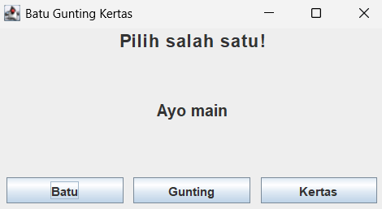
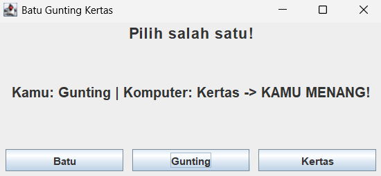
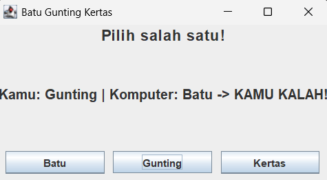
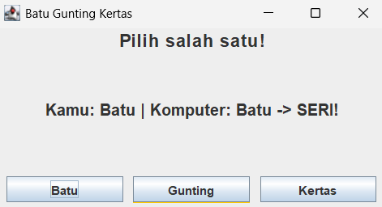
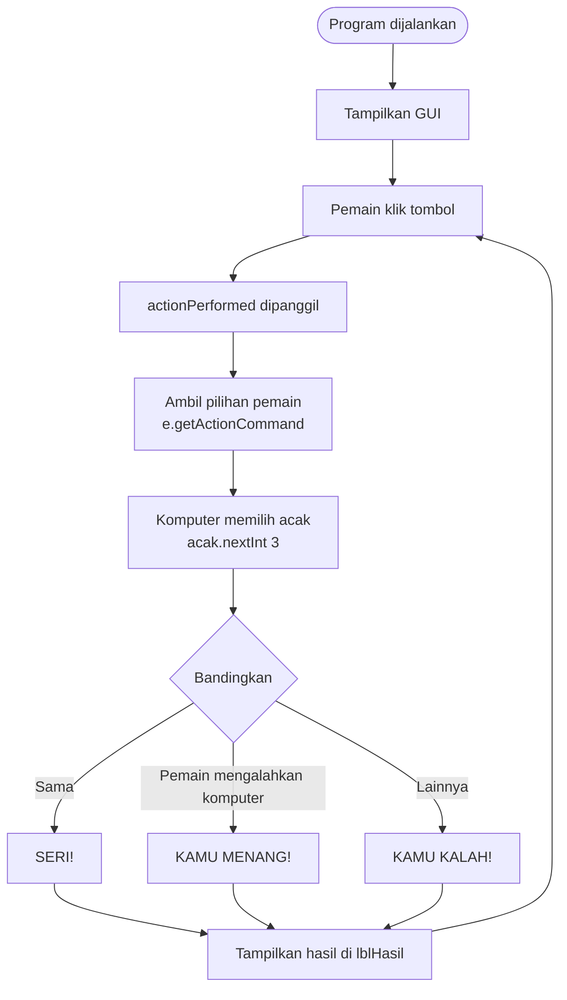

# ✊✋✌️ Batu Gunting Kertas

> Game Batu Gunting Kertas berbasis **GUI Java Swing**.
> Dibuat untuk memenuhi tugas eksplorasi GUI: *Top-level Container, Intermediate Container, Atomic Component, Layout Classes, dan Event Listener*.


---

## 👤 Identitas

| | |
|---|---|
| **Nama** | I Putu Reynanda Putra Dynatha |
| **NIM** | F1D02510115 |
| **Kelas** | B |

---

## 📖 Deskripsi Program

Pemain memilih salah satu dari tiga tombol: **Batu**, **Gunting**, atau **Kertas**.
Komputer lalu memilih secara **acak**, dan program menampilkan hasilnya: **menang**, **kalah**, atau **seri**.

### Aturan Permainan

| Pilihan Kamu | Mengalahkan |
|---|---|
| ✊ Batu | ✌️ Gunting |
| ✌️ Gunting | ✋ Kertas |
| ✋ Kertas | ✊ Batu |

Jika pilihan pemain dan komputer **sama**, hasilnya **seri**.

---

## 📸 Tampilan Program

### 1. Tampilan Awal
Saat program pertama kali dijalankan, pemain diminta memilih salah satu tombol.



### 2. Hasil: Menang 🎉
Pemain menang jika pilihannya mengalahkan pilihan komputer.



### 3. Hasil: Kalah 😢
Pemain kalah jika pilihan komputer mengalahkan pilihannya.



### 4. Hasil: Seri 🤝
Hasil seri jika pilihan pemain dan komputer sama.



---

## ✅ Implementasi Ketentuan Tugas

| No | Ketentuan | Implementasi | Lokasi di Kode |
|---|---|---|---|
| 1 | **Top-level Container** | `JFrame` | `class BatuGuntingKertas extends JFrame` |
| 2 | **Intermediate Container** | `JPanel` | `panelTombol` |
| 3 | **Atomic Component** | `JLabel`, `JButton` | `lblJudul`, `lblHasil`, tombol Batu / Gunting / Kertas |
| 4 | **Layout Classes** (minimal 2) | `BorderLayout`, `GridLayout` | layout frame dan layout panel tombol |
| 5 | **Event Listener** | `ActionListener`, `MouseAdapter` | `actionPerformed()`, `mouseEntered()`, `mouseExited()` |

### 🧩 Susunan Layout

```
┌───────────────────────────────┐
│   NORTH  : lblJudul           │   ← BorderLayout (JFrame)
├───────────────────────────────┤
│   CENTER : lblHasil           │
├───────────────────────────────┤
│ SOUTH : panelTombol           │
│ ┌───────┬─────────┬─────────┐ │   ← GridLayout 1x3 (JPanel)
│ │ Batu  │ Gunting │ Kertas  │ │
│ └───────┴─────────┴─────────┘ │
└───────────────────────────────┘
```

### 🎯 Event Listener: Interface dan Abstract Class

| Jenis | Yang Dipakai | Cara Implementasi |
|---|---|---|
| **Interface** | `ActionListener` | `implements ActionListener`, lalu method `actionPerformed()` **wajib** di-override |
| **Abstract Class** | `MouseAdapter` | dibuat sebagai *anonymous class*, lalu cukup override `mouseEntered()` dan `mouseExited()` |

> 💡 **Kenapa memakai `MouseAdapter`?**
> `MouseAdapter` adalah abstract class yang sudah berisi method kosong dari interface `MouseListener`.
> Jadi kita hanya perlu meng-override method yang dibutuhkan saja (efek hover), tanpa menulis ketujuh method `MouseListener`.

---

## 🔄 Alur Program



---

## 🚀 Cara Menjalankan

**Prasyarat:** sudah terpasang **JDK 8 atau lebih baru**.

```bash
# 1. Compile
javac BatuGuntingKertas.java

# 2. Jalankan
java BatuGuntingKertas
```

---

## 📁 Struktur Folder

```
📦 Tugas-GUI
 ┣ 📂 screenshot
 ┃ ┣ 🖼️ tampilanawal.png
 ┃ ┣ 🖼️ menang.png
 ┃ ┣ 🖼️ kalah.png
 ┃ ┗ 🖼️ seri.png
 ┣ 📜 BatuGuntingKertas.java
 ┗ 📄 README.md
```

---

## 🧠 Penjelasan Kode

1. **Pembuatan tombol dengan perulangan.** Tiga tombol dibuat dari array `pilihan` memakai `for`, sehingga kode tidak ditulis berulang.
2. **Pendaftaran listener.** Setiap tombol didaftarkan dengan `addActionListener(this)`, karena class ini sudah meng-*implement* `ActionListener`.
3. **Membaca tombol yang diklik.** `e.getActionCommand()` mengembalikan teks tombol, yaitu pilihan pemain.
4. **Pilihan komputer.** `acak.nextInt(3)` menghasilkan angka 0, 1, atau 2 yang dipakai sebagai indeks array `pilihan`.
5. **Penentuan hasil.** Program memakai `if-else`: sama berarti seri, tiga kombinasi menang berarti menang, selain itu kalah.
6. **Efek hover.** `MouseAdapter` mengubah warna tombol menjadi oranye saat kursor masuk, dan mengembalikannya saat kursor keluar.

---

## 💻 Kode Program

<details>
<summary><b>Klik untuk melihat kode lengkap</b></summary>

```java
import java.awt.*;
import java.awt.event.*;
import java.util.Random;
import javax.swing.*;

public class BatuGuntingKertas extends JFrame implements ActionListener {

    private String[] pilihan = {"Batu", "Gunting", "Kertas"};
    private Random acak = new Random();

    private JLabel lblJudul = new JLabel("Pilih salah satu!", SwingConstants.CENTER);
    private JLabel lblHasil = new JLabel("Ayo main", SwingConstants.CENTER);

    public BatuGuntingKertas() {
        setTitle("Batu Gunting Kertas");
        setSize(400, 220);
        setDefaultCloseOperation(EXIT_ON_CLOSE);
        setLocationRelativeTo(null);
        setLayout(new BorderLayout());

        lblJudul.setFont(new Font("SansSerif", Font.BOLD, 18));
        lblHasil.setFont(new Font("SansSerif", Font.BOLD, 16));

        JPanel panelTombol = new JPanel(new GridLayout(1, 3, 10, 10));
        panelTombol.setBorder(BorderFactory.createEmptyBorder(10, 10, 10, 10));

        for (String nama : pilihan) {
            JButton btn = new JButton(nama);
            btn.addActionListener(this);

            btn.addMouseListener(new MouseAdapter() {
                @Override
                public void mouseEntered(MouseEvent e) {
                    btn.setBackground(Color.ORANGE);
                }

                @Override
                public void mouseExited(MouseEvent e) {
                    btn.setBackground(null);
                }
            });
            panelTombol.add(btn);
        }

        add(lblJudul, BorderLayout.NORTH);
        add(lblHasil, BorderLayout.CENTER);
        add(panelTombol, BorderLayout.SOUTH);
    }

    @Override
    public void actionPerformed(ActionEvent e) {
        String pemain = e.getActionCommand();
        String komputer = pilihan[acak.nextInt(3)];

        String hasil;
        if (pemain.equals(komputer)) {
            hasil = "SERI!";
        } else if (pemain.equals("Batu") && komputer.equals("Gunting")
                || pemain.equals("Gunting") && komputer.equals("Kertas")
                || pemain.equals("Kertas") && komputer.equals("Batu")) {
            hasil = "KAMU MENANG!";
        } else {
            hasil = "KAMU KALAH!";
        }

        lblHasil.setText("Kamu: " + pemain + " | Komputer: " + komputer + " -> " + hasil);
    }

    public static void main(String[] args) {
        new BatuGuntingKertas().setVisible(true);
    }
}
```

</details>

---

## 🛠️ Teknologi

- **Bahasa:** Java
- **Library GUI:** Swing (`javax.swing`) dan AWT (`java.awt`)
- **Konsep:** Container, Component, Layout Manager, Event Handling

---

<p align="center">
  Dibuat oleh <b>I Putu Reynanda Putra Dynatha</b> (F1D02510115) · Kelas B
</p>
